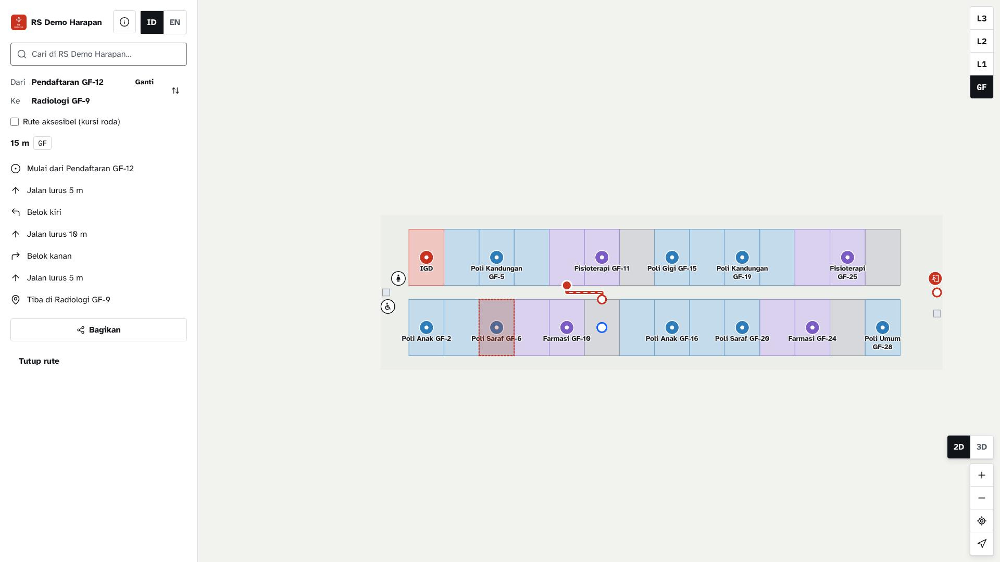
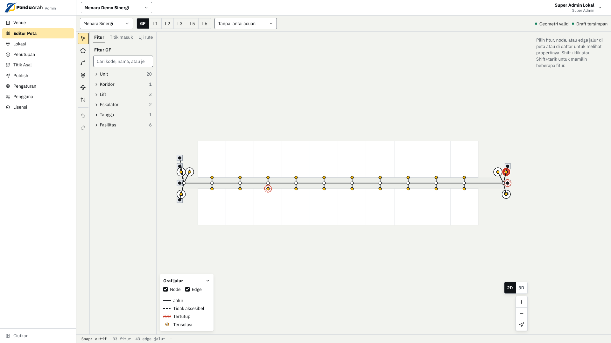
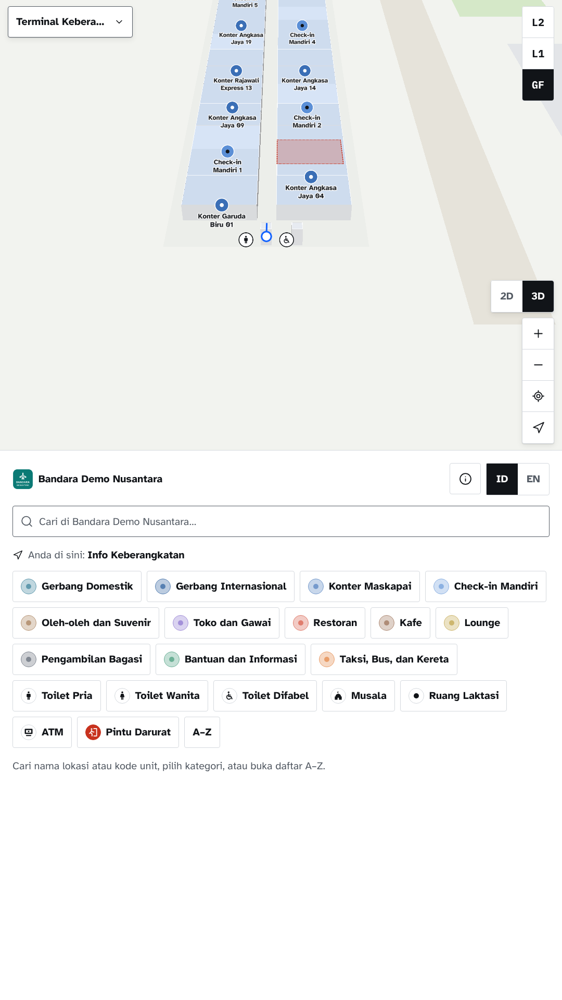
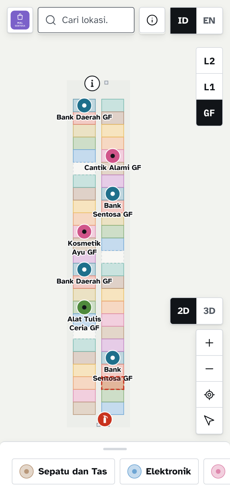
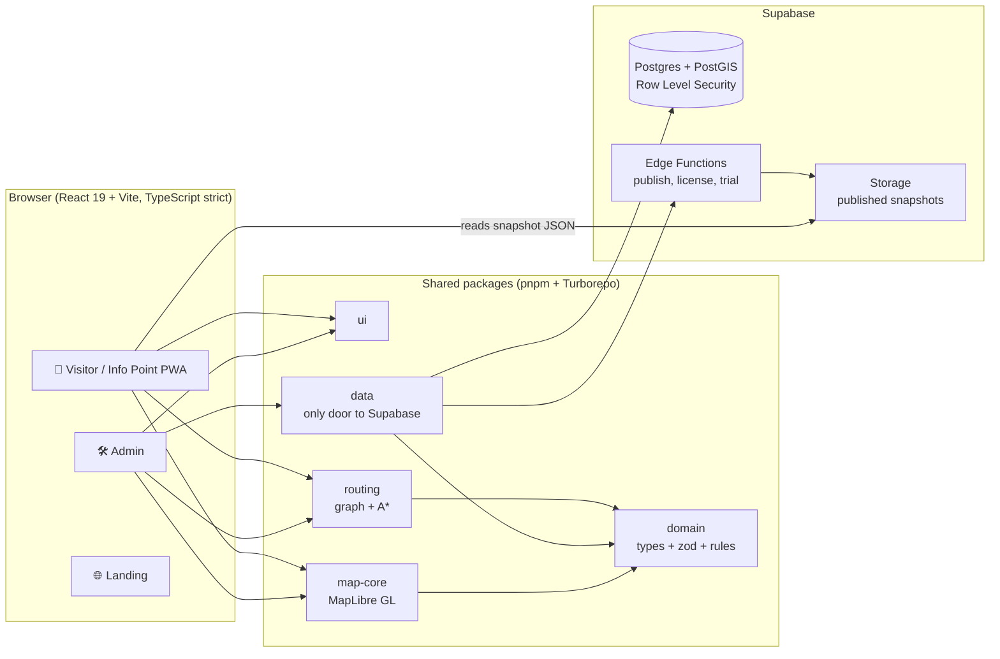

<p align="center">
  
</p>

<h3 align="center">Lost inside a building? Scan the code, then follow the map.</h3>

<p align="center">
  PanduArah turns a floor plan into a map with step-by-step directions on the visitor's own phone.<br>
  For hospitals, campuses, offices, airports, factories and shopping malls.<br>
  <b>No beacons to buy. No app to download.</b>
</p>

<p align="center">
  <a href="https://github.com/devaldicaliesta/indoor-map/actions/workflows/ci.yml"></a>
  
  
  
  
  
</p>

> 🇮🇩 Versi Bahasa Indonesia (utama): [`README.md`](README.md) · English copy of the README · full playbook in [`docs/`](docs/00-README.md).

## Submission links

| | |
| --- | --- |
| 🌐 **Try it live** (Visitor, no login) | https://app.panduarah.my.id/v/demo |
| ☁️ **Hosting** | Cloudflare Pages (frontends) + Supabase (backend). **Not Google Cloud**; the reasoning is in [Deployment](#deployment) |
| 🏠 Product site and free trial | https://panduarah.my.id |
| 🛠️ Admin (map editor) | https://admin.panduarah.my.id (needs an account; request a free workspace on the product site) |
| 🎬 Demo video (under 3 minutes) | `REPLACE-WITH-VIDEO-URL` |
| 🎞️ Pitch deck | `REPLACE-WITH-DECK-URL` |
| 🎥 Technical tour: architecture, code and roadmap (about 10 min) | `REPLACE-WITH-TOUR-VIDEO-URL` |

### Try it in 60 seconds

1. Open the live demo. You land in **RS Demo Harapan**, a fictional four-floor hospital with 154 locations.
2. Type **"Radiologi"**, open the result, tap **Route here**, and pick **Pendaftaran** as the starting point.
3. Follow the steps. The route changes floors by lift or stairs, and the map follows.
4. Tick **Wheelchair-accessible route** and watch the path change. Then try **2D / 3D** and the **ID / EN** toggle.
5. Want another building? Change the address to `/v/demo-mal`, `/v/demo-kampus`, `/v/demo-kantor`, `/v/demo-bandara`, `/v/demo-pabrik`, or `/v/demo-konser` (stadium).

## The problem

The blue dot on your phone disappears right at the front door. GPS does not work indoors, and the rest is left to signs and security guards. Patients are late for appointments in sprawling hospitals. Students and guests circle around campuses. Passengers run through terminals. Front-desk staff answer "where is…?" all day.

Many indoor-navigation products rely on beacons and native SDKs: hardware to buy and install, an app to download, and a bill that has grown before a single visitor has been helped.

## The answer

**PanduArah** covers the whole loop, from drawing the map to getting a visitor to the destination, in three apps:

- **Admin:** a web editor for building managers. Upload a floor plan (PNG, JPG, PDF or DXF), draw floors, rooms, corridors, lifts and stairs, link each room to a searchable location, and publish a versioned map with one click.
- **Visitor:** a PWA opened from a QR code or link. Visitors search for a destination, see it in 2D or 3D, and follow directions across floors and buildings. Temporary closures are taken into account right away.
- **Info Point:** the same Visitor app in kiosk mode for the lobby touch screen, with a fixed "You are here".

How does the app know where you are? From a **QR code at a known point**, a kiosk, or a manual pick. That is why there is no hardware to install in the building.

### Features

| Area | What it does |
| --- | --- |
| Map editor | Multi-venue, multi-building, multi-floor; polygon / line / point drawing with snapping, undo / redo, georeferenced floor plans, DXF import (layer picker), validation with visible findings |
| Routing | A\* on a per-floor graph; lifts, escalators (directional), stairs and building doors; wheelchair-accessible mode; routes recalculated around closures; ID / EN turn-by-turn text from editable templates |
| Operations | Industry templates (hospital, campus, office, airport, factory, mall), CSV / Excel import, aliases, opening hours, location status, versioned publish with diff and rollback, edit locks per floor |
| Visitor | Offline-capable PWA, search with typo tolerance, categories and A-Z directory, share deep links, 2D / 3D, animated route, mini people in the crowd layer, venue branding |
| Governance | 5 roles enforced by Postgres Row Level Security, audit log, license and quota system, EULA acceptance, personal-data export / deletion |
| Trial hosting | Prospects request a 17-day workspace; an Edge Function provisions an isolated venue, Admin account and Visitor link automatically |

### Screens

| Route across floors | Map editor | Kiosk (Info Point) | Phone |
| --- | --- | --- | --- |
|  |  |  |  |

## Architecture



Design decisions that matter:

- **Visitors read a published snapshot, not the database.** One versioned JSON file (plus a separate graph file) is cached by the service worker. Search and routing run **on the phone**, so the server stays cheap and the app keeps working offline.
- **Pure logic is separate from UI.** `packages/domain` and `packages/routing` have no React, Supabase or MapLibre dependency, so the same code validates in the editor, publishes in an Edge Function and routes on the phone.
- **Authorization lives in the database.** Every policy goes through `app.*` wrapper functions and Row Level Security. Hiding a button is never the access control.
- **Portable data.** One data package talks to Supabase; GeoJSON in WGS84 everywhere; no vendor-specific data model.

### Measured results

From [`docs/laporan-performa.md`](docs/laporan-performa.md) (on-premise package in Docker; mid-range phone emulation, CPU throttled 4×):

| Check | Result | Target |
| --- | --- | --- |
| Farthest route on a 10-floor, 2,000-feature venue (tap to steps) | **206 ms** | ≤ 500 ms |
| Routing benchmark, 20,000-edge graph | 3.3 ms | |
| Publish a venue | **5.8 s** | ≤ 60 s |
| First load on 4G | 3.1 s (was 4.9 s) | ≤ 3 s, 0.1 s short |
| Load test: 200 visitors + 20 admins | **0 of 9,440 requests failed**, p95 API 12 ms | |
| Accessibility (axe, WCAG 2.x A/AA) | **0 violations on 15 pages** | |
| Browsers | Chromium, WebKit, Pixel 7, iPhone 13 pass; Firefox not verified (no WebGL in the test container) | |

Quality gates in the repo: 206 Vitest files, 43 pgTAP files for RLS and SQL functions, 101 Playwright specs, about 60 SQL migrations, 11 Edge Functions, and a CI workflow plus a Security workflow (`pnpm audit`, `pip-audit`, gitleaks, Trivy).

## Tech stack

| Layer | Technology |
| --- | --- |
| Monorepo | pnpm workspace, Turborepo |
| Frontend | React 19, Vite, TypeScript (strict), Tailwind + shadcn/ui, React Router, TanStack Query, Zustand, i18next |
| Map | MapLibre GL JS (no internet basemap), terra-draw editor, `fill-extrusion` for 3D |
| Backend | Supabase: Postgres + PostGIS, Auth, Storage, Edge Functions (Deno) |
| Services | `services/cad-converter` (Python, DXF to per-layer images) |
| Quality | Vitest, pgTAP, Playwright, Biome |
| Hosting | Cloudflare Pages (static frontends) + Supabase (backend); optional on-premise Docker package |

## Getting started (local)

Prerequisites: **Node 22** (see `.nvmrc`), **pnpm 10.33** (`corepack enable`), **Docker** (for the local Supabase stack).

```bash
git clone https://github.com/devaldicaliesta/indoor-map.git
cd indoor-map
corepack enable
pnpm install

cp .env.example .env.local
#   set SEED_ADMIN_PASSWORD (min. 8 characters) in .env.local

pnpm exec supabase start      # prints the local API URL and keys
#   put the anon / publishable key into VITE_SUPABASE_ANON_KEY in .env.local

pnpm db:reset                 # applies all migrations + seed, creates admin@local.test
pnpm db:seed-demo             # optional, ~20 s: seven rich demo venues, routes, closures

pnpm dev                      # Admin http://localhost:5173 · Visitor http://localhost:5174
pnpm dev:landing              # Landing http://localhost:5175
```

- Sign in to Admin as `admin@local.test` with the `SEED_ADMIN_PASSWORD` you chose. Other seeded roles: `pengelola@`, `editor@`, `operator@`, `viewer@local.test`, same password.
- Open the Visitor at `http://localhost:5174/v/demo` (after `db:seed-demo`).
- The Admin interface is in Indonesian; the Visitor and Info Point are Indonesian and English.

### Tests

```bash
pnpm check              # typecheck + lint + unit tests (must be green before any PR)
pnpm test:integration   # repository and RLS tests against the local Supabase
pnpm test:e2e           # Playwright main flows (needs the local Supabase and pnpm db:reset)
```

## Deployment

**PanduArah is published on Cloudflare Pages (the web apps) and Supabase (database, auth, storage, Edge Functions). It is not deployed on Google Cloud**, so this submission has no Cloud Run or Firebase App Distribution link. The live URLs are in the table at the top.

| Part | Where it runs |
| --- | --- |
| Landing, Visitor, Admin | Cloudflare Pages, built from the `production` branch (`pnpm --filter @indoor/<app> build`) |
| Database, auth, storage, Edge Functions | Supabase (Postgres + PostGIS), Singapore region |
| Cost | Rp 0 per month on the free tiers |

Step-by-step runbook: [`deploy/hosting/README.md`](deploy/hosting/README.md) and [`deploy/hosting/cloudflare-pages.md`](deploy/hosting/cloudflare-pages.md).

### Mobile

The Visitor is an installable **PWA** ("Add to Home Screen" on Android and iOS), so there is no native app and nothing to distribute through an app-distribution service.

### On-premise package

Enterprise clients can instead run the whole stack on their own server with Docker Compose ([`deploy/README.md`](deploy/README.md)): HTTPS gateway, Postgres + PostGIS, Auth, Storage, Edge Runtime, CAD converter, nightly backups, upgrade and rollback scripts, signed-license activation.

## Project structure

```
apps/        admin · visitor (+ Info Point at /ip/:code) · landing · vendor
packages/    domain · routing · map-core · data · ui
supabase/    migrations (plain SQL) · functions (Edge Functions) · tests (pgTAP)
services/    cad-converter (Python)
deploy/      hosting (Cloudflare Pages + Supabase) · on-premise package
e2e/         Playwright flows and screenshot evidence per task
docs/        product, architecture, data model, specs, progress, performance report
```

## Roadmap

Detailed plan: [`docs/20-F2-fase-2.md`](docs/20-F2-fase-2.md) and [`docs/PROGRESS.md`](docs/PROGRESS.md).

| Horizon | Focus |
| --- | --- |
| **Now** | Admin 2FA (TOTP, in progress) then SSO; visitor-without-WebGL fallback; pen-test and fixes; real-device performance run |
| **Next** | Landmark-based directions and walking-time estimates; nearest facility and multi-stop routes; scheduled publish; printable maps and "You are here" boards; multi-language content; usage analytics; GeoJSON / IMDF export; API and webhooks |
| **Later** | 3D object library and GLB models; automatic floor-plan scanning from images; Info Point device management and a Windows shell; events and promotions; PostgreSQL on the client's own database; Windows Server install |

## How it was built

Built by [Devaldi Caliesta](https://github.com/devaldicaliesta). Work is organised as numbered tasks in `docs/` with written acceptance criteria, each verified by tests and screenshots under `e2e/evidence/`. AI coding assistance (Claude Code) was used under the rules in [`CLAUDE.md`](CLAUDE.md); every change goes through the same `pnpm check` gate.

## License

© 2026 Devaldi Caliesta. All rights reserved. The source is shared for evaluation of this submission. Third-party open-source notices: [`deploy/SUMBER-TERBUKA.md`](deploy/SUMBER-TERBUKA.md) and the notices generated into each app build.
