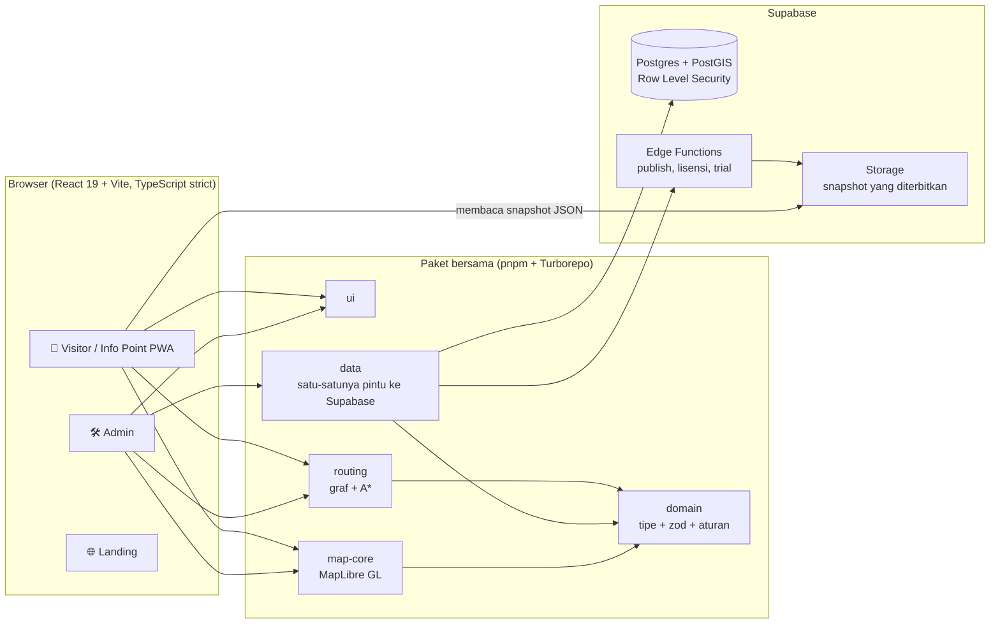

<p align="center">
  
</p>

<h3 align="center">Tersesat di dalam gedung? Pindai kodenya, lalu ikuti petanya.</h3>

<p align="center">
  PanduArah mengubah denah gedung menjadi peta dan petunjuk arah langkah demi langkah di ponsel pengunjung.<br>
  Untuk rumah sakit, kampus, perkantoran, bandara, pabrik, dan pusat perbelanjaan.<br>
  <b>Tanpa beacon yang harus dibeli. Tanpa aplikasi yang harus diunduh.</b>
</p>

<p align="center">
  <a href="https://github.com/devaldicaliesta/indoor-map/actions/workflows/ci.yml"></a>
  
  
  
  
  
</p>

> Playbook lengkap ada di [`docs/`](docs/00-README.md).

## Tautan submission

| | |
| --- | --- |
| 🌐 **Coba langsung** (Visitor, tanpa login) | https://app.panduarah.my.id/v/demo |
| ☁️ **Dihosting di** | Cloudflare Pages (frontend) + Supabase (backend). **Bukan Google Cloud**; alasannya ada di bagian [Deployment](#deployment) |
| 🏠 Situs produk dan trial gratis 17 hari | https://panduarah.my.id |
| 🛠️ Admin (editor peta) | https://admin.panduarah.my.id (butuh akun; minta ruang kerja gratis lewat situs produk) |
| 🎬 Video demo (di bawah 3 menit) | https://youtu.be/pSLm7RZvioE |
| 🎞️ Pitch deck | https://drive.google.com/drive/folders/1fAwisU3IpBYeNKnXQmyUKZD4KD9qyPXW?usp=sharing |
| 🎥 Video tur teknis: arsitektur, kode, dan roadmap (±9 menit) | https://drive.google.com/file/d/1dddGov9Tze6_D4WmzuM0Ql6P9N-5iVlS/view?usp=sharing |

### Coba dalam 60 detik

1. Buka demo langsung. Anda masuk ke **RS Demo Harapan**, rumah sakit fiktif empat lantai dengan 154 lokasi.
2. Ketik **“Radiologi”**, buka hasilnya, ketuk **Rute ke sini**, lalu pilih **Pendaftaran** sebagai titik awal.
3. Ikuti langkah-langkahnya. Rute berpindah lantai lewat lift atau tangga, dan petanya ikut berpindah.
4. Centang **Rute aksesibel (kursi roda)** dan lihat jalurnya berubah. Lalu coba **2D / 3D** dan tombol bahasa **ID / EN**.
5. Mau gedung lain? Ganti alamatnya menjadi `/v/demo-mal`, `/v/demo-kampus`, `/v/demo-kantor`, `/v/demo-bandara`, `/v/demo-pabrik`, atau `/v/demo-konser` (stadion).

## Masalahnya

Titik biru di ponsel Anda menghilang tepat di pintu masuk. GPS tidak bekerja di dalam gedung, dan sisanya diserahkan kepada papan petunjuk dan satpam. Pasien terlambat ke janji temu di rumah sakit yang luas. Mahasiswa dan tamu berputar-putar di kampus. Penumpang berlari di terminal. Petugas meja depan menjawab “di mana ya…?” sepanjang hari.

Banyak solusi navigasi dalam gedung bertumpu pada beacon dan SDK native: perangkat keras yang harus dibeli dan dipasang, aplikasi yang harus diunduh, dan biaya yang sudah membengkak sebelum satu pengunjung pun terbantu.

## Jawabannya

**PanduArah** menutup seluruh alurnya, dari menggambar peta sampai mengantar pengunjung ke tujuan, lewat tiga aplikasi:

- **Admin**: editor web untuk pengelola gedung. Unggah denah (PNG, JPG, PDF, atau DXF), gambar lantai, ruangan, koridor, lift, dan tangga, tautkan tiap ruangan ke lokasi yang bisa dicari, lalu terbitkan peta berversi dengan satu klik.
- **Visitor**: PWA yang dibuka dari kode QR atau tautan. Pengunjung mencari tujuan, melihatnya dalam 2D atau 3D, lalu mengikuti petunjuk lintas lantai dan lintas gedung. Penutupan sementara langsung ikut diperhitungkan.
- **Info Point**: aplikasi Visitor yang sama dalam mode kios untuk layar sentuh di lobi, dengan penanda “Anda di sini” yang tetap.

Dari mana aplikasi tahu posisi Anda? Dari **kode QR di titik yang sudah diketahui**, dari kios, atau dari pilihan manual. Karena itu tidak ada perangkat keras yang perlu dipasang di gedung.

### Yang bisa dilakukan

| Bagian | Isinya |
| --- | --- |
| Editor peta | Banyak venue, gedung, dan lantai. Gambar poligon, garis, dan titik dengan snapping, undo / redo, denah tergeoreferensi, dan impor DXF per layer. Kesalahan geometri terlihat langsung sebagai temuan validasi |
| Routing | A\* pada graf per lantai, dengan lift, eskalator (berarah), tangga, dan pintu gedung. Ada mode rute aksesibel, rute otomatis memutar saat ada penutupan, dan teks petunjuk ID / EN dari template yang bisa diubah |
| Operasional | Template per jenis gedung, impor CSV / Excel, alias pencarian, jam operasional, dan status lokasi. Publish berversi lengkap dengan diff dan rollback, serta kunci sunting per lantai agar dua orang tidak saling menimpa |
| Visitor | PWA yang tetap jalan tanpa internet, pencarian yang memaafkan salah ketik, kategori dan direktori A-Z, tautan bagikan, 2D / 3D, rute beranimasi, dan branding per venue |
| Tata kelola | Lima role yang ditegakkan Row Level Security Postgres, log audit, lisensi dan kuota, persetujuan EULA, serta ekspor dan hapus data pribadi |
| Trial hosting | Calon klien meminta ruang kerja 17 hari. Edge Function menyiapkan venue terisolasi, akun Admin, dan tautan Visitor secara otomatis |

### Tampilan

| Rute lintas lantai | Editor peta | Kios (Info Point) | Ponsel |
| --- | --- | --- | --- |
|  |  |  |  |

## Cara kerjanya



Empat keputusan yang membentuk sisanya:

- **Visitor membaca snapshot, bukan menembak database.** Peta diterbitkan sebagai satu berkas JSON berversi (graf jalan dipisah ke berkas sendiri) yang di-cache service worker. Satu-satunya bacaan langsung adalah daftar penutupan aktif yang kecil. Pencarian dan routing berjalan **di ponsel**, jadi server tetap ringan saat pengunjung ramai, dan aplikasi tetap hidup tanpa internet.
- **Logika dipisah dari tampilan.** `packages/domain` dan `packages/routing` tidak mengenal React, Supabase, maupun MapLibre. Kode yang sama memvalidasi di editor, menerbitkan di Edge Function, dan menghitung rute di ponsel.
- **Keamanan ada di database.** Setiap policy melewati fungsi `app.*` dan Row Level Security. Menyembunyikan tombol tidak pernah dianggap kontrol akses.
- **Data bisa dipindah.** Hanya satu paket yang berbicara dengan Supabase. Geometri selalu GeoJSON WGS84, tanpa format yang terkunci pada satu vendor.

### Hasil ukur

Angka di bawah diukur, bukan ditebak, dan yang meleset dari target tetap dicantumkan. Sumbernya [`docs/laporan-performa.md`](docs/laporan-performa.md): paket on-premise di Docker, emulasi ponsel kelas menengah dengan CPU diperlambat 4×.

| Pengujian | Hasil | Target |
| --- | --- | --- |
| Rute terjauh di venue 10 lantai dan 2.000 fitur (ketuk sampai langkah) | **206 ms** | ≤ 500 ms |
| Benchmark routing, graf 20.000 edge | 3,3 ms | |
| Publish satu venue | **5,8 dtk** | ≤ 60 dtk |
| Muat awal di 4G | 3,1 dtk (sebelumnya 4,9) | ≤ 3 dtk, meleset 0,1 dtk |
| Uji beban: 200 pengunjung + 20 admin | **0 dari 9.440 permintaan gagal**, p95 API 12 ms | |
| Aksesibilitas (axe, WCAG 2.x A/AA) | **0 pelanggaran di 15 halaman** | |
| Browser | Chromium, WebKit, Pixel 7, iPhone 13 lulus; Firefox belum terverifikasi (tanpa WebGL di kontainer uji) | |

Penjaga kualitas di repo: 206 berkas Vitest, 43 berkas pgTAP untuk RLS dan fungsi SQL, 101 spec Playwright, sekitar 60 migrasi SQL, dan 11 Edge Function. CI berjalan di setiap perubahan, ditambah workflow keamanan (`pnpm audit`, `pip-audit`, gitleaks, Trivy).

## Stack teknologi

| Lapisan | Teknologi |
| --- | --- |
| Monorepo | pnpm workspace, Turborepo |
| Frontend | React 19, Vite, TypeScript (strict), Tailwind + shadcn/ui, React Router, TanStack Query, Zustand, i18next |
| Peta | MapLibre GL JS (tanpa basemap internet), editor terra-draw, `fill-extrusion` untuk 3D |
| Backend | Supabase: Postgres + PostGIS, Auth, Storage, Edge Functions (Deno) |
| Layanan | `services/cad-converter` (Python, DXF menjadi gambar per layer) |
| Kualitas | Vitest, pgTAP, Playwright, Biome |
| Hosting | Cloudflare Pages (frontend statis) + Supabase (backend); paket Docker on-premise opsional |

## Memulai (lokal)

Prasyarat: **Node 22** (lihat `.nvmrc`), **pnpm 10.33** (`corepack enable`), **Docker** (untuk Supabase lokal).

```bash
git clone https://github.com/devaldicaliesta/indoor-map.git
cd indoor-map
corepack enable
pnpm install

cp .env.example .env.local
#   isi SEED_ADMIN_PASSWORD (minimal 8 karakter) di .env.local

pnpm exec supabase start      # menampilkan URL API lokal dan kunci
#   salin kunci anon / publishable ke VITE_SUPABASE_ANON_KEY di .env.local

pnpm db:reset                 # terapkan semua migrasi + seed, buat admin@local.test
pnpm db:seed-demo             # opsional, ±20 dtk: tujuh venue demo lengkap, rute, penutupan

pnpm dev                      # Admin http://localhost:5173 · Visitor http://localhost:5174
pnpm dev:landing              # Landing http://localhost:5175
```

- Masuk ke Admin sebagai `admin@local.test` dengan `SEED_ADMIN_PASSWORD` yang Anda pilih. Role seed lain: `pengelola@`, `editor@`, `operator@`, `viewer@local.test`, password sama.
- Buka Visitor di `http://localhost:5174/v/demo` (setelah `db:seed-demo`).
- Antarmuka Admin berbahasa Indonesia; Visitor dan Info Point tersedia dalam bahasa Indonesia dan Inggris.

### Pengujian

```bash
pnpm check              # typecheck + lint + test unit (wajib hijau sebelum PR)
pnpm test:integration   # test repository dan RLS terhadap Supabase lokal
pnpm test:e2e           # alur utama Playwright (butuh Supabase lokal dan pnpm db:reset)
```

## Deployment

**PanduArah berjalan di Cloudflare Pages (aplikasi web) dan Supabase (database, auth, storage, Edge Function). Proyek ini tidak memakai Google Cloud**, jadi submission ini tidak punya tautan Cloud Run maupun Firebase App Distribution. Alamat live ada di tabel paling atas.

| Bagian | Dijalankan di |
| --- | --- |
| Landing, Visitor, Admin | Cloudflare Pages, dibangun dari branch `production` (`pnpm --filter @indoor/<app> build`) |
| Database, auth, storage, Edge Function | Supabase (Postgres + PostGIS), region Singapura |
| Biaya | Rp 0 per bulan di paket gratis |

Panduan langkah demi langkah: [`deploy/hosting/README.md`](deploy/hosting/README.md) dan [`deploy/hosting/cloudflare-pages.md`](deploy/hosting/cloudflare-pages.md).

### Mobile

Visitor adalah **PWA**: buka tautannya, lalu “Tambahkan ke layar utama” di Android atau iOS bila perlu. Tidak ada aplikasi native, jadi tidak ada build yang harus dibagikan lewat layanan distribusi aplikasi.

### Paket on-premise

Klien besar yang ingin datanya tetap di jaringan sendiri bisa menjalankan seluruh sistem di server sendiri dengan Docker Compose ([`deploy/README.md`](deploy/README.md)): gateway HTTPS, Postgres + PostGIS, Auth, Storage, Edge Runtime, konverter CAD, backup harian, skrip upgrade dan rollback, serta aktivasi lisensi bertanda tangan.

## Struktur proyek

```
apps/        admin · visitor (+ Info Point di /ip/:code) · landing · vendor
packages/    domain · routing · map-core · data · ui
supabase/    migrations (SQL) · functions (Edge Function) · tests (pgTAP)
services/    cad-converter (Python)
deploy/      hosting (Cloudflare Pages + Supabase) · paket on-premise
e2e/         alur Playwright dan bukti tangkapan layar per task
docs/        produk, arsitektur, model data, spesifikasi, progres, laporan performa
```

## Roadmap

Rencana rinci: [`docs/20-F2-fase-2.md`](docs/20-F2-fase-2.md) dan [`docs/PROGRESS.md`](docs/PROGRESS.md).

| Horizon | Fokus |
| --- | --- |
| **Sekarang** | 2FA Admin (TOTP, sedang dikerjakan) lalu SSO; cadangan untuk browser tanpa WebGL; uji penetrasi dan perbaikannya; uji performa di perangkat nyata |
| **Berikutnya** | Petunjuk berbasis landmark dan estimasi waktu jalan; fasilitas terdekat dan rute multi-tujuan; publish terjadwal; peta cetak dan papan "Anda di sini"; konten multi-bahasa; analitik penggunaan; ekspor GeoJSON / IMDF; API dan webhook |
| **Nanti** | Pustaka objek 3D dan model GLB; pemindaian denah otomatis dari gambar; manajemen perangkat Info Point dan shell Windows; event dan promosi; PostgreSQL milik klien; instalasi Windows Server |

## Dibuat oleh siapa, dan bagaimana

Dibangun oleh [Devaldi Caliesta](https://github.com/devaldicaliesta). Pekerjaan dipecah menjadi task bernomor di `docs/`, masing-masing dengan kriteria selesai yang tertulis dan dibuktikan lewat test serta tangkapan layar di `e2e/evidence/`. Claude Code dipakai sebagai asisten dengan aturan di [`CLAUDE.md`](CLAUDE.md), dan setiap perubahan tetap harus melewati gerbang `pnpm check` yang sama.

## Lisensi

© 2026 Devaldi Caliesta. Hak cipta dilindungi. Kode sumber dibagikan untuk penilaian submission ini. Pemberitahuan lisensi pihak ketiga: [`deploy/SUMBER-TERBUKA.md`](deploy/SUMBER-TERBUKA.md) dan berkas pemberitahuan yang dihasilkan di setiap build aplikasi.
