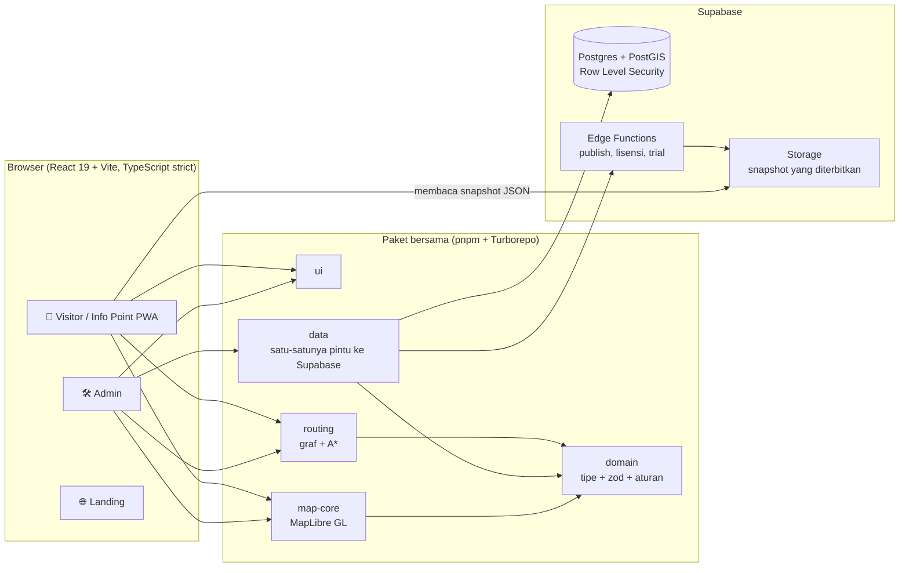

<p align="center">
  
</p>

<h3 align="center">Peta dalam gedung dan navigasi langkah demi langkah untuk semua jenis gedung</h3>

<p align="center">
  Rumah sakit, kampus, perkantoran, bandara, pabrik, dan pusat perbelanjaan: buat petanya sekali,
  terbitkan, dan pengunjung menemukan jalannya dari ponsel apa pun, tanpa aplikasi yang harus dipasang dan tanpa beacon yang harus dibeli.
</p>

<p align="center">
  <a href="https://github.com/devaldicaliesta/indoor-map/actions/workflows/ci.yml"></a>
  
  
  
  
  
</p>

> 🇬🇧 English copy: [`README.en.md`](README.en.md) · playbook lengkap di [`docs/`](docs/00-README.md).

## Tautan submission

| | |
| --- | --- |
| 🌐 **Demo langsung (Visitor, tanpa login)** | https://app.panduarah.my.id/v/demo |
| ☁️ **Hosting** | Cloudflare Pages (frontend) + Supabase (backend). **Tidak di-deploy di Google Cloud**, lihat [Deployment](#deployment) |
| 🏠 Situs produk dan trial gratis | https://panduarah.my.id |
| 🛠️ Admin (editor peta) | https://admin.panduarah.my.id (minta ruang kerja gratis 17 hari lewat situs produk) |
| 🎬 Demo video (≤ 3 menit) | `GANTI-DENGAN-URL-VIDEO-DEMO` |
| 🎞️ Pitch deck | `GANTI-DENGAN-URL-PITCH-DECK` |
| 🎥 Backup video: arsitektur dan roadmap (≤ 15 menit) | `GANTI-DENGAN-URL-VIDEO-BACKUP` |

### Tur 60 detik untuk juri

1. Buka demo langsung. Isinya **RS Demo Harapan**, rumah sakit fiktif 4 lantai dengan 154 lokasi.
2. Cari **"Radiologi"**, buka, ketuk **Rute ke sini**, lalu pilih **Pendaftaran** sebagai titik awal.
3. Ikuti langkahnya: rute melintasi lantai lewat lift atau tangga. Aktifkan **rute aksesibel (kursi roda)**, lalu coba **2D / 3D** dan tombol bahasa **ID / EN**.
4. Venue demo lain: `/v/demo-mal` (mal), `/v/demo-kampus` (kampus), `/v/demo-kantor` (menara perkantoran), `/v/demo-bandara` (bandara), `/v/demo-pabrik` (pabrik), `/v/demo-konser` (stadion).

## Masalah

GPS berhenti bekerja begitu kita melangkah masuk gedung. Pasien terlambat ke janji temu di rumah sakit yang luas, mahasiswa dan tamu berkeliling di kampus, penumpang terburu-buru di terminal, dan petugas meja depan menjawab "di mana ya…?" sepanjang hari. Produk positioning dalam gedung yang ada bergantung pada beacon dan SDK native, sehingga mahal dan lambat dipasang.

## Solusi

**PanduArah** adalah platform lengkap, bukan sekadar penampil peta:

- **Admin:** editor web tempat pengelola gedung menggambar lantai, ruangan, koridor, lift, dan tangga di atas denah yang diunggah (PNG, JPG, PDF, atau DXF), menautkan ruangan ke lokasi yang bisa dicari, lalu menerbitkan snapshot berversi dengan satu klik.
- **Visitor:** PWA yang dibuka dari kode QR atau tautan. Cari, lihat tempatnya dalam 2D atau 3D, dan dapatkan petunjuk langkah demi langkah lintas lantai dan gedung, dengan penutupan sementara yang langsung diperhitungkan.
- **Info Point:** aplikasi Visitor yang sama dalam mode kios di layar sentuh lobi, dengan penanda "Anda di sini" yang tetap.

Posisi "Anda di sini" berasal dari **kode QR di titik yang diketahui**, kios, atau pilihan manual, jadi tidak ada perangkat keras yang harus dipasang.

### Fitur

| Area | Kemampuan |
| --- | --- |
| Editor peta | Multi-venue, multi-gedung, multi-lantai; menggambar poligon / garis / titik dengan snapping, undo / redo, denah tergeoreferensi, impor DXF (pilih layer), validasi dengan temuan yang terlihat |
| Routing | A\* pada graf per lantai; lift, eskalator (berarah), tangga, dan pintu gedung; mode rute aksesibel; rute dihitung ulang menghindari penutupan; teks petunjuk ID / EN dari template yang bisa diubah |
| Operasional | Template industri (rumah sakit, kampus, perkantoran, bandara, pabrik, mal), impor CSV / Excel, alias, jam operasional, status lokasi, publish berversi dengan diff dan rollback, kunci edit per lantai |
| Visitor | PWA yang bisa dipakai offline, pencarian toleran salah ketik, kategori dan direktori A-Z, tautan bagikan, 2D / 3D, rute beranimasi, orang mini di lapisan keramaian, branding venue |
| Tata kelola | 5 role yang ditegakkan oleh Row Level Security Postgres, log audit, sistem lisensi dan kuota, persetujuan EULA, ekspor dan hapus data pribadi |
| Trial hosting | Calon klien meminta ruang kerja 17 hari; Edge Function menyiapkan venue terisolasi, akun Admin, dan tautan Visitor secara otomatis |

### Tampilan

| Rute lintas lantai | Editor peta | Kios (Info Point) | Ponsel |
| --- | --- | --- | --- |
|  |  |  |  |

## Arsitektur



Keputusan desain yang penting:

- **Visitor membaca snapshot yang sudah diterbitkan, bukan query ke database.** Satu berkas JSON berversi (ditambah berkas graf terpisah) di-cache oleh service worker, dan satu-satunya bacaan langsung adalah daftar penutupan aktif yang kecil. Pencarian dan routing berjalan **di ponsel**, sehingga server tetap ringan dan aplikasi tetap berjalan tanpa internet.
- **Logika murni dipisah dari UI.** `packages/domain` dan `packages/routing` tidak bergantung pada React, Supabase, atau MapLibre, sehingga kode yang sama memvalidasi di editor, menerbitkan di Edge Function, dan menghitung rute di ponsel.
- **Otorisasi ada di database.** Setiap policy melewati fungsi pembungkus `app.*` dan Row Level Security. Menyembunyikan tombol tidak pernah menjadi kontrol akses.
- **Data portabel.** Satu paket data berbicara dengan Supabase; GeoJSON WGS84 di mana-mana; tanpa model data khusus satu vendor.

### Hasil ukur

Dari [`docs/laporan-performa.md`](docs/laporan-performa.md) (paket on-premise di Docker; emulasi ponsel kelas menengah, CPU diperlambat 4×):

| Pengujian | Hasil | Target |
| --- | --- | --- |
| Rute terjauh di venue 10 lantai dan 2.000 fitur (ketuk sampai langkah) | **206 ms** | ≤ 500 ms |
| Benchmark routing, graf 20.000 edge | 3,3 ms | |
| Publish satu venue | **5,8 dtk** | ≤ 60 dtk |
| Muat awal di 4G | 3,1 dtk (sebelumnya 4,9) | ≤ 3 dtk, meleset 0,1 dtk |
| Uji beban: 200 pengunjung + 20 admin | **0 dari 9.440 permintaan gagal**, p95 API 12 ms | |
| Aksesibilitas (axe, WCAG 2.x A/AA) | **0 pelanggaran di 15 halaman** | |
| Browser | Chromium, WebKit, Pixel 7, iPhone 13 lulus; Firefox belum terverifikasi (tanpa WebGL di kontainer uji) | |

Gerbang kualitas di repo: 206 berkas Vitest, 43 berkas pgTAP untuk RLS dan fungsi SQL, 101 spec Playwright, sekitar 60 migrasi SQL, 11 Edge Function, serta workflow CI dan workflow Security (`pnpm audit`, `pip-audit`, gitleaks, Trivy).

## Stack teknologi

| Lapisan | Teknologi |
| --- | --- |
| Monorepo | pnpm workspace, Turborepo |
| Frontend | React 19, Vite, TypeScript (strict), Tailwind + shadcn/ui, React Router, TanStack Query, Zustand, i18next |
| Peta | MapLibre GL JS (tanpa basemap internet), editor terra-draw, `fill-extrusion` untuk 3D |
| Backend | Supabase: Postgres + PostGIS, Auth, Storage, Edge Functions (Deno) |
| Layanan | `services/cad-converter` (Python, DXF menjadi gambar per layer) |
| Kualitas | Vitest, pgTAP, Playwright, Biome |
| Hosting | Cloudflare Pages (frontend statis) + Supabase (backend); paket Docker on-premise opsional |

## Memulai (lokal)

Prasyarat: **Node 22** (lihat `.nvmrc`), **pnpm 10.33** (`corepack enable`), **Docker** (untuk Supabase lokal).

```bash
git clone https://github.com/devaldicaliesta/indoor-map.git
cd indoor-map
corepack enable
pnpm install

cp .env.example .env.local
#   isi SEED_ADMIN_PASSWORD (minimal 8 karakter) di .env.local

pnpm exec supabase start      # menampilkan URL API lokal dan kunci
#   salin kunci anon / publishable ke VITE_SUPABASE_ANON_KEY di .env.local

pnpm db:reset                 # terapkan semua migrasi + seed, buat admin@local.test
pnpm db:seed-demo             # opsional, ±20 dtk: tujuh venue demo lengkap, rute, penutupan

pnpm dev                      # Admin http://localhost:5173 · Visitor http://localhost:5174
pnpm dev:landing              # Landing http://localhost:5175
```

- Masuk ke Admin sebagai `admin@local.test` dengan `SEED_ADMIN_PASSWORD` yang Anda pilih. Role seed lain: `pengelola@`, `editor@`, `operator@`, `viewer@local.test`, password sama.
- Buka Visitor di `http://localhost:5174/v/demo` (setelah `db:seed-demo`).
- Antarmuka Admin berbahasa Indonesia; Visitor dan Info Point tersedia dalam bahasa Indonesia dan Inggris.

### Pengujian

```bash
pnpm check              # typecheck + lint + test unit (wajib hijau sebelum PR)
pnpm test:integration   # test repository dan RLS terhadap Supabase lokal
pnpm test:e2e           # alur utama Playwright (butuh Supabase lokal dan pnpm db:reset)
```

## Deployment

**PanduArah dipublikasikan di Cloudflare Pages (aplikasi web) dan Supabase (database, auth, storage, Edge Function). Proyek ini tidak di-deploy di Google Cloud**, jadi submission ini tidak memiliki tautan Cloud Run maupun Firebase App Distribution. URL live ada di tabel paling atas.

| Bagian | Dijalankan di |
| --- | --- |
| Landing, Visitor, Admin | Cloudflare Pages, dibangun dari branch `production` (`pnpm --filter @indoor/<app> build`) |
| Database, auth, storage, Edge Function | Supabase (Postgres + PostGIS), region Singapura |
| Biaya | Rp 0 per bulan di paket gratis |

Panduan langkah demi langkah: [`deploy/hosting/README.md`](deploy/hosting/README.md) dan [`deploy/hosting/cloudflare-pages.md`](deploy/hosting/cloudflare-pages.md).

### Mobile

Visitor adalah **PWA** yang bisa dipasang ("Tambahkan ke layar utama" di Android dan iOS), jadi tidak ada aplikasi native dan tidak ada yang perlu didistribusikan lewat layanan distribusi aplikasi.

### Paket on-premise

Klien enterprise dapat menjalankan seluruh sistem di server sendiri dengan Docker Compose ([`deploy/README.md`](deploy/README.md)): gateway HTTPS, Postgres + PostGIS, Auth, Storage, Edge Runtime, konverter CAD, backup harian, skrip upgrade dan rollback, serta aktivasi lisensi bertanda tangan.

## Struktur proyek

```
apps/        admin · visitor (+ Info Point di /ip/:code) · landing · vendor
packages/    domain · routing · map-core · data · ui
supabase/    migrations (SQL) · functions (Edge Function) · tests (pgTAP)
services/    cad-converter (Python)
deploy/      hosting (Cloudflare Pages + Supabase) · paket on-premise
e2e/         alur Playwright dan bukti tangkapan layar per task
docs/        produk, arsitektur, model data, spesifikasi, progres, laporan performa
```

## Roadmap

Rencana rinci: [`docs/20-F2-fase-2.md`](docs/20-F2-fase-2.md) dan [`docs/PROGRESS.md`](docs/PROGRESS.md).

| Horizon | Fokus |
| --- | --- |
| **Sekarang** | 2FA Admin (TOTP, sedang dikerjakan) lalu SSO; cadangan untuk browser tanpa WebGL; uji penetrasi dan perbaikannya; uji performa di perangkat nyata |
| **Berikutnya** | Petunjuk berbasis landmark dan estimasi waktu jalan; fasilitas terdekat dan rute multi-tujuan; publish terjadwal; peta cetak dan papan "Anda di sini"; konten multi-bahasa; analitik penggunaan; ekspor GeoJSON / IMDF; API dan webhook |
| **Nanti** | Pustaka objek 3D dan model GLB; pemindaian denah otomatis dari gambar; manajemen perangkat Info Point dan shell Windows; event dan promosi; PostgreSQL milik klien; instalasi Windows Server |

## Cara pembuatan

Dibangun oleh [Devaldi Caliesta](https://github.com/devaldicaliesta). Pekerjaan diatur sebagai task bernomor di `docs/` dengan kriteria penerimaan tertulis, masing-masing diverifikasi lewat test dan tangkapan layar di `e2e/evidence/`. Bantuan AI (Claude Code) dipakai dengan aturan di [`CLAUDE.md`](CLAUDE.md); setiap perubahan melewati gerbang `pnpm check` yang sama.

## Lisensi

© 2026 Devaldi Caliesta. Hak cipta dilindungi. Kode sumber dibagikan untuk penilaian submission ini. Pemberitahuan lisensi pihak ketiga: [`deploy/SUMBER-TERBUKA.md`](deploy/SUMBER-TERBUKA.md) dan berkas pemberitahuan yang dihasilkan di setiap build aplikasi.
