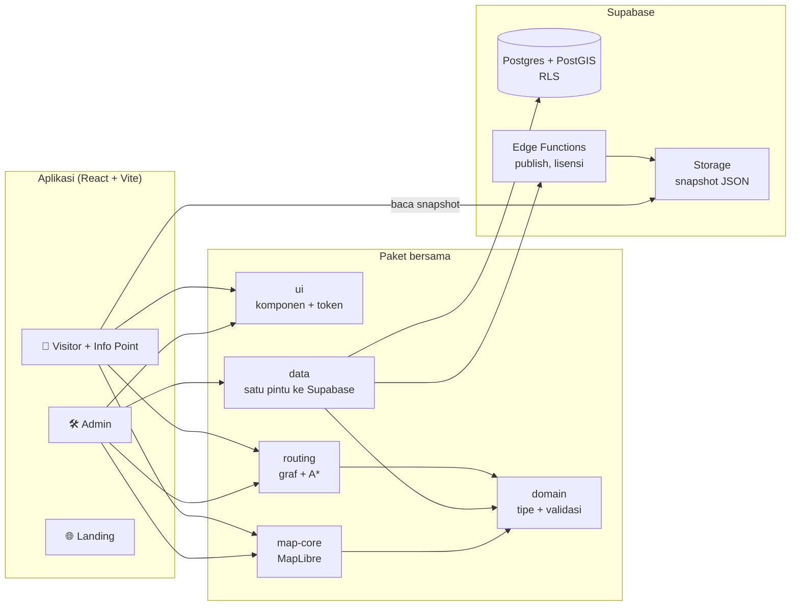
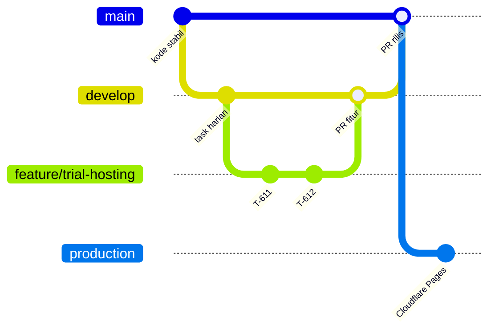

<p align="center">
  
</p>

<h3 align="center">Indoor Navigation untuk semua jenis gedung</h3>

<p align="center">
  Peta dan navigasi dalam gedung untuk rumah sakit, kampus, perkantoran, bandara, pabrik, dan pusat perbelanjaan.<br>
  Dipasang on-premise di server klien, hak pakai lewat lisensi berlangganan.
</p>

<p align="center">
  <a href="https://github.com/devaldicaliesta/indoor-map/actions/workflows/ci.yml"></a>
  
  
  
  
  
</p>

<p align="center">
  <a href="https://panduarah.my.id"><b>🌐 panduarah.my.id</b></a> ·
  <a href="docs/PROGRESS.md"><b>📋 Progress</b></a> ·
  <a href="docs/00-README.md"><b>📚 Playbook</b></a> ·
  <a href="docs/23-trial-hosting.md"><b>🧪 PRD Trial Hosting</b></a>
</p>

---

## 📊 Dashboard status

> Ringkasan dari [`docs/PROGRESS.md`](docs/PROGRESS.md), per **26 Oktober 2026**. Rincian setiap task ada di sana.

| | |
| --- | --- |
| 🚀 **Rilis aktif** | F2.1 Siap jual |
| ⏭️ **Task berikutnya** | T-599 (tur panduan driver.js) |
| 🧪 **Menunggu review** | T-511 (distribusi image Docker jadi), T-512 (Visitor tanpa WebGL), T-514 (perbaikan lisensi dan audit R4), T-521 (panduan Windows; uji manual Hyper-V belum) |

| Rilis | Isi | Progres | Task |
| --- | --- | --- | --- |
| **R0** Fondasi | Monorepo, skema, auth, layout | `████████████████████` 100% | 13 · ✅ |
| **R1** Inti peta | Editor peta multi-gedung, jelajah Visitor | `████████████████████` 100% | 20 · ✅ |
| **R2** Navigasi | Graf rute, konektor, rute aksesibel, QR | `████████████████████` 100% | 17 · ✅ |
| **R3** Operasional | Template, import, publish berversi | `████████████████████` 100% | 14 · ✅ |
| **V** Visitor komersial | Tampilan Visitor bergaya peta indoor | `████████████████████` 100% | 8 · ✅ |
| **R4** Komersial | Lisensi, kuota, Info Point, paket instalasi | `████████████████████` 100% | 13 · ✅ |
| **F2** Fase 2 | Siap jual, keamanan, fitur pembeda | `███░░░░░░░░░░░░░░░░░` 15% | 60 · ✅ 5 · 🟡 4 · ⬜ 37 · ⚪ 14 |
| **F2-K** Trial hosting | Trial otomatis di Supabase + Cloudflare | `████████████████████` 100% | 14 · ✅ |

**Keterangan status:** ✅ selesai · 🟡 review (sudah dibangun, menunggu review pemilik) · 🔵 dikerjakan · ⬜ siap (dependensi selesai) · ⚪ menunggu · 🔴 diblokir

Progres menghitung task yang sudah dibangun (`review` atau `selesai`).

---

## 🧩 Aplikasi

| | Aplikasi | Untuk siapa | Isi |
| --- | --- | --- | --- |
| 🛠️ | **Admin** `apps/admin` | Pengelola gedung | Editor peta, jalur navigasi, lokasi, titik asal, publish, pengguna, lisensi |
| 📱 | **Visitor** `apps/visitor` | Pengunjung (HP) | Cari lokasi, rute langkah demi langkah, peta 2D/3D, ID/EN |
| 🖥️ | **Info Point** `/ip/:code` | Layar sentuh di lobi | Mode dari Visitor, titik "Anda di sini" tetap |
| 🌐 | **Landing** `apps/landing` | Calon klien | Situs vendor, demo peta 3D. Bukan bagian paket klien |

## 🏗️ Arsitektur



Aturan utamanya: komponen React tidak memanggil Supabase langsung (semua lewat `packages/data`), logika bisnis ada di `domain` dan `routing`, dan otorisasi selalu di server (RLS). Rincian di [`docs/03-arsitektur.md`](docs/03-arsitektur.md).

## 🌿 Alur branch



| Branch | Fungsi | Diubah lewat |
| --- | --- | --- |
| 🟢 `production` | Versi yang live di Cloudflare Pages | Merge dari `main` saat rilis |
| 🔵 `main` | Kode stabil, CI hijau | PR dari `develop` |
| 🟣 `develop` | Pengembangan harian | Push langsung atau PR dari `feature/*` |
| 🟠 `feature/<nama>` | Fitur besar, mis. `feature/trial-hosting` | Push langsung, dihapus setelah digabung |

Aturan lengkap: [`docs/07-aturan-branch.md`](docs/07-aturan-branch.md).

## 🧰 Stack

| Lapisan | Teknologi |
| --- | --- |
| Monorepo | pnpm workspace + Turborepo |
| Frontend | React 19, Vite 8, TypeScript 7 (strict), Tailwind 4 + shadcn/ui, React Router, TanStack Query, Zustand |
| Peta | MapLibre GL JS 6, terra-draw (editor), `fill-extrusion` untuk 3D |
| Data | Supabase: Postgres + PostGIS, Auth, Storage, Edge Functions |
| Layanan | `services/cad-converter` (Python, DXF → gambar per layer) |
| Kualitas | Vitest, pgTAP, Playwright, Biome |

## ▶️ Menjalankan

```bash
pnpm install
supabase start         # butuh Docker
pnpm db:reset          # seed + Super Admin admin@local.test
pnpm dev               # Admin :5173, Visitor :5174
pnpm dev:landing       # Landing :5175
pnpm check             # typecheck + lint + test (wajib hijau sebelum PR)
pnpm test:e2e          # Playwright
```

## 📁 Struktur

```
apps/        admin · visitor · landing · vendor
packages/    domain · routing · map-core · data · ui
supabase/    migrations (SQL) · functions (Edge Functions) · tests (pgTAP)
services/    cad-converter (Python)
deploy/      paket instalasi on-premise: build rilis vendor (image Docker jadi) dan skrip pasang di klien
e2e/         test Playwright + bukti screenshot per task
docs/        playbook, spesifikasi, PRD, progress
```

## 📚 Dokumen penting

| Dokumen | Isi |
| --- | --- |
| [`docs/00-README.md`](docs/00-README.md) | Peta playbook dan urutan baca |
| [`docs/PROGRESS.md`](docs/PROGRESS.md) | Status setiap task, keputusan, pertanyaan terbuka |
| [`docs/01-produk.md`](docs/01-produk.md) | Produk, pengguna, istilah, role |
| [`docs/03-arsitektur.md`](docs/03-arsitektur.md) | Arsitektur dan aturan paket |
| [`docs/23-trial-hosting.md`](docs/23-trial-hosting.md) | PRD dan arsitektur trial ter-hosting |
| [`deploy/README.md`](deploy/README.md) | Rilis vendor (image Docker jadi) dan instalasi on-premise dari arsip |
| [`CLAUDE.md`](CLAUDE.md) | Aturan kerja untuk agen AI |

Dengan Claude Code, satu task dikerjakan dengan `/kerjakan-task T-xxx`.

<p align="center"><sub>Logo resmi dan turunannya: <code>packages/ui/src/brand/</code> · sumber pemilik di <code>docs/brand/</code></sub></p>
