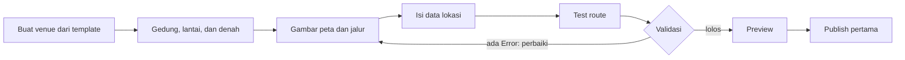
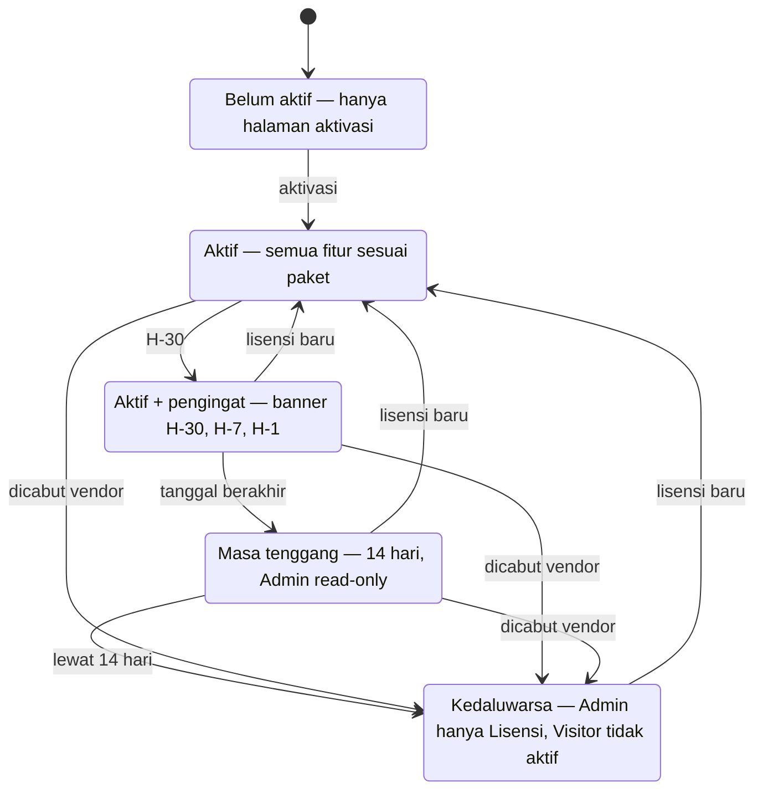

# Proses Bisnis

Sembilan proses bisnis di bawah ini mencakup seluruh siklus hidup sistem di sisi klien, dari aktivasi lisensi sampai operasional harian. Setiap proses mencantumkan tujuan, aktor, pemicu, langkah, output, dan pengecualian, serta merujuk ID kebutuhan di tab Kebutuhan Fungsional.

| ID | Proses | Aktor utama | Frekuensi |
| --- | --- | --- | --- |
| BP-01 | Aktivasi sistem dan setup awal | Tim IT klien, Super Admin, Vendor | Sekali per instalasi |
| BP-02 | Setup venue baru sampai publish pertama | Admin, Editor | Sekali per venue |
| BP-03 | Onboarding lokasi baru | Admin, Editor | Rutin |
| BP-04 | Perubahan status lokasi | Admin, Editor | Rutin |
| BP-05 | Penutupan sementara | Operator, Admin | Insidental |
| BP-06 | Perubahan layout (renovasi) | Admin, Editor | Jarang |
| BP-07 | Pemasangan titik asal (QR dan Info Point) | Admin, Operator, Tim IT klien | Per perangkat |
| BP-08 | Publish dan rollback | Admin | Setiap ada perubahan |
| BP-09 | Siklus lisensi | Vendor, Super Admin, Sistem | Per periode langganan |

**Aktor:** Vendor (Anda), Tim IT klien (memasang server dan perangkat), Super Admin, Admin, Editor, Operator (petugas lapangan yang mengelola penutupan), Viewer (manajemen yang hanya melihat), dan Sistem (proses otomatis).

## BP-01 Aktivasi sistem dan setup awal

- **Tujuan:** instalasi baru di server klien aktif dengan lisensi sah dan siap dipakai tim klien.
- **Pemicu:** klien menandatangani kontrak langganan.
- **Output:** sistem aktif, akun pengguna klien siap.

1. &#91;Vendor\] Membuat lisensi untuk klien dan mengirim kunci lisensi beserta paket instalasi.
2. &#91;Tim IT klien\] Memasang sistem di server klien.
3. &#91;Super Admin\] Membuka Admin; sistem hanya menampilkan halaman aktivasi (FR-LIC-01).
4. &#91;Super Admin\] Memasukkan kunci lisensi.
5. &#91;Sistem\] Mengirim `instance_id` ke server vendor, menerima file lisensi, dan memverifikasinya (FR-LIC-02).
6. &#91;Super Admin\] Membuat akun awal: password sendiri, lalu Admin, Editor, Operator, dan Viewer sesuai kebutuhan (FR-AUTH-03), lalu mengisi Pengaturan Sistem: URL publik Visitor dan server email (FR-SYS-01).
7. &#91;Super Admin\] Memeriksa halaman status lisensi: paket, masa berlaku, dan kuota sesuai kontrak (FR-LIC-05).

**Pengecualian:**

- Aktivasi online gagal → Super Admin mengirim `instance_id` ke vendor, lalu mengunggah file lisensi secara manual.
- Paket di halaman status tidak sesuai kontrak → Super Admin menghubungi vendor sebelum mulai memasukkan data.

## BP-02 Setup venue baru sampai publish pertama

- **Tujuan:** venue baru tampil di Visitor dan Info Point dengan peta dan navigasi yang valid.
- **Pemicu:** klien menambahkan venue baru (gedung pertama atau venue tambahan).
- **Output:** versi published pertama venue.

1. &#91;Admin\] Membuat venue dan memilih tipe venue; sistem mengisi template (FR-VEN-01, FR-VEN-02).
2. &#91;Admin\] Menambah gedung dan lantai (FR-VEN-04, FR-VEN-05).
3. &#91;Admin\] Mengunggah denah tiap lantai dan melakukan georeferensi (FR-VEN-07, FR-VEN-08).
4. &#91;Editor\] Menggambar unit, dinding, pintu, fasilitas, dan konektor vertikal (FR-MAP).
5. &#91;Editor\] Menggambar jalur, menghubungkan titik masuk unit, dan mengatur lift, eskalator, tangga (FR-NAV).
6. &#91;Admin\] Menyesuaikan tipe lokasi dan field kustom, lalu mengisi atau mengimpor data lokasi (FR-LOC).
7. &#91;Admin\] Mengatur tampilan 2D/3D dan kamera awal (FR-VIS).
8. &#91;Editor\] Menguji rute ke beberapa tujuan, termasuk mode kursi roda (FR-NAV-10).
9. &#91;Sistem\] Menjalankan validasi; Error dikembalikan ke Editor untuk diperbaiki (FR-PUB-03).
10. &#91;Admin\] Memeriksa preview lalu publish (FR-PUB-05, FR-PUB-06).

Setiap Error dari validasi kembali ke tahap gambar peta dan jalur; hanya draft yang lolos yang masuk preview dan publish.

**Pengecualian:**

- Kuota venue, gedung, atau lantai tercapai → penambahan ditolak; Super Admin menghubungi vendor untuk upgrade paket.
- Denah berupa CAD dengan satuan tidak jelas → skala diatur manual dengan pengukur jarak.

## BP-03 Onboarding lokasi baru

- **Tujuan:** lokasi baru (poli, ruang kelas, ruang rapat, gate, toko) dapat dicari dan dituju pengunjung.
- **Pemicu:** ruang atau layanan baru dibuka (poli, laboratorium, ruang kelas, divisi, gerai), atau pemindahan unit.
- **Output:** lokasi aktif di versi published.

1. &#91;Admin\] Menerima data lokasi dari pihak terkait (manajemen rumah sakit, bagian umum kampus, facility management gedung, bagian pengelola gerai).
2. &#91;Admin\] Memastikan unit tujuan sudah ada di peta dan berstatus kosong; jika belum, Editor menggambarnya (FR-MAP-06).
3. &#91;Admin\] Membuat lokasi dengan tipe yang sesuai dan mengisi field kustom, atau mengimpor banyak lokasi sekaligus (FR-LOC-03, FR-LOC-08).
4. &#91;Admin\] Menautkan lokasi ke unit melalui kode unit (FR-LOC-04).
5. &#91;Admin\] Mengatur status: aktif, atau segera buka dengan tanggal (FR-LOC-05).
6. &#91;Admin\] Menambah alias pencarian bila perlu (FR-LOC-09).
7. &#91;Admin\] Menjalankan BP-08 (publish).

**Pengecualian:**

- Unit masih ditempati lokasi aktif lain → sistem menolak tautan; lokasi lama harus diubah statusnya dulu (BP-04).
- Field wajib belum lengkap → lokasi tersimpan sebagai draft dan muncul sebagai peringatan saat validasi.

## BP-04 Perubahan status lokasi

- **Tujuan:** pengunjung tidak diarahkan ke lokasi yang tutup, pindah, atau belum buka.
- **Pemicu:** renovasi, tutup sementara, pindah unit, kontrak berakhir, atau lokasi segera buka.
- **Output:** status lokasi dan unit terbarui di versi published.

1. &#91;Admin\] Membuka data lokasi dan mengubah status (FR-LOC-05):
   - Nonaktif sementara → lokasi tetap tampil dengan label, misalnya "Sedang renovasi".
   - Nonaktif permanen → lokasi hilang dari pencarian; sistem otomatis mengubah unit menjadi kosong.
   - Pindah unit → tautan ke unit lama dilepas dan ditautkan ke unit baru.
2. &#91;Admin\] Memperbarui jam operasional bila berubah (FR-LOC-06).
3. &#91;Admin\] Menjalankan BP-08 (publish).

**Pengecualian:**

- Status "segera buka" dengan tanggal yang sudah lewat → muncul sebagai peringatan saat validasi.

## BP-05 Penutupan sementara

- **Tujuan:** rute otomatis menghindari area atau konektor yang tidak bisa dilalui.
- **Pemicu:** lift atau eskalator rusak/maintenance, area dibersihkan, acara, atau keadaan darurat lokal.
- **Output:** rute di Visitor dan Info Point menghindari elemen tertutup, tanpa perlu publish.

1. &#91;Operator\] Menemukan atau menerima laporan gangguan di lapangan beserta perkiraan waktu selesai.
2. &#91;Operator\] Membuat penutupan langsung dari Admin: memilih area, jalur, lift, atau eskalator, lalu mengisi alasan, waktu mulai, dan waktu selesai bila diketahui (FR-NAV-08).
3. &#91;Sistem\] Menerapkan penutupan langsung ke Visitor dan Info Point tanpa publish.
4. &#91;Admin\] Mengecek dampaknya dengan test route bahwa rute alternatif tersedia, termasuk mode kursi roda (FR-NAV-10).
5. &#91;Sistem\] Membuka kembali otomatis saat waktu selesai tercapai.
6. &#91;Operator\] Jika perbaikan selesai lebih cepat atau lebih lambat, mengakhiri atau memperpanjang penutupan secara manual.

**Pengecualian:**

- Penutupan membuat suatu lantai tidak terjangkau dengan kursi roda (misalnya satu-satunya lift) → sistem memperingatkan Admin; Visitor menampilkan pesan bahwa rute aksesibel tidak tersedia sementara.

## BP-06 Perubahan layout (renovasi)

- **Tujuan:** peta dan jalur sesuai kondisi fisik terbaru setelah renovasi atau penataan ulang.
- **Pemicu:** renovasi, penggabungan atau pemecahan unit, penambahan lantai atau gedung.
- **Output:** versi published baru sesuai layout terbaru.

1. &#91;Admin\] Mengunggah denah baru bila tersedia; denah lama tetap tersimpan (FR-VEN-07).
2. &#91;Editor\] Mengunci lantai terkait lalu mengubah geometri: menggabung, memecah, atau menghapus unit (FR-AUTH-05, FR-MAP-03).
3. &#91;Editor\] Memperbarui jalur dan titik masuk unit yang terdampak (FR-NAV-01, FR-NAV-03).
4. &#91;Admin\] Memperbarui tautan lokasi ke unit yang berubah (FR-LOC-04).
5. &#91;Editor\] Menguji rute di area terdampak (FR-NAV-10).
6. &#91;Admin\] Menjalankan BP-08 (publish).

**Pengecualian:**

- Selama renovasi berlangsung, area terdampak ditutup lewat BP-05 agar peta lama tidak mengarahkan pengunjung ke area kerja.
- Unit yang dihapus masih tertaut lokasi atau Info Point → sistem meminta konfirmasi dan melepas tautannya.

## BP-07 Pemasangan titik asal (QR dan Info Point)

- **Tujuan:** pengunjung mendapat titik "Anda di sini" dengan posisi dan arah hadap yang benar.
- **Pemicu:** venue baru, penambahan titik asal, atau perpindahan/penggantian Info Point.
- **Output:** QR titik asal terpasang dan/atau Info Point menampilkan versi published terbaru.

**QR titik asal:**

1. &#91;Admin\] Membuat titik asal: nama, gedung, lantai, posisi, dan arah hadap; sistem menghubungkannya ke jalur terdekat (FR-DEV-01, FR-DEV-02).
2. &#91;Admin\] Mengunduh QR lalu mencetaknya.
3. &#91;Operator\] Menempel QR di lokasi yang sesuai (pilar, lift, pintu masuk) dengan arah yang sama seperti di peta.
4. &#91;Operator\] Memindai QR dengan HP dan mencoba satu rute; jika posisi atau arah meleset, Admin mengoreksinya.

**Info Point (opsional):**

1. &#91;Admin\] Mendaftarkan Info Point: nama/kode, lantai, posisi, dan arah hadap (FR-DEV-03), lalu mengatur konfigurasinya (FR-DEV-04).
2. &#91;Admin\] Menyalin URL mode Info Point.
3. &#91;Tim IT klien\] Memasang perangkat layar sentuh dan membuka URL tersebut di browser layar penuh.
4. &#91;Tim IT klien\] Mencocokkan arah peta dengan arah hadap fisik dan mencoba satu rute; jika meleset, Admin mengoreksi posisi atau arah.
5. &#91;Admin\] Menjalankan BP-08 bila posisi titik asal diubah, karena titik asal ikut divalidasi.

**Pengecualian:**

- Kuota Info Point tercapai → pendaftaran ditolak (FR-LIC-06).
- QR rusak, hilang, atau dipindah → Admin mengunduh ulang QR atau memperbarui posisinya; QR lama tetap valid selama titik asal tidak dihapus.

## BP-08 Publish dan rollback

- **Tujuan:** perubahan sampai ke pengunjung dengan aman, dan dapat dibatalkan jika bermasalah.
- **Pemicu:** ada perubahan draft yang siap tayang, atau versi published terbukti bermasalah.
- **Output:** versi published baru (publish) atau versi lama aktif kembali (rollback).

**Publish:**

1. &#91;Admin\] Membuka ringkasan perubahan sejak versi terakhir (FR-PUB-02).
2. &#91;Sistem\] Menjalankan validasi (FR-PUB-03).
3. &#91;Admin/Editor\] Memperbaiki semua Error; Peringatan boleh diterima dengan sadar (FR-PUB-04).
4. &#91;Admin\] Memeriksa preview tampilan Info Point dan HP (FR-PUB-05).
5. &#91;Admin\] Publish dengan catatan rilis (FR-PUB-06).
6. &#91;Sistem\] Membuat snapshot berversi; Info Point memuat versi baru.

**Rollback:**

1. &#91;Admin\] Menerima laporan masalah (rute salah, lokasi hilang) setelah publish.
2. &#91;Admin\] Memilih versi sebelumnya di riwayat versi dan menjalankan rollback (FR-PUB-07, FR-PUB-08).
3. &#91;Sistem\] Mengaktifkan versi tersebut; draft tetap utuh.
4. &#91;Editor\] Memperbaiki masalah di draft, lalu publish ulang lewat alur di atas.

**Pengecualian:**

- Editor tidak dapat publish atau rollback; Editor memberi tahu Admin setelah draft siap.
- Lisensi dalam masa tenggang atau kuota terlampaui → publish diblokir (FR-LIC-09, FR-LIC-10).

## BP-09 Siklus lisensi

- **Tujuan:** hak pakai klien selalu sesuai langganan yang dibayar, tanpa mengganggu pengunjung secara mendadak.
- **Pemicu:** masa langganan mendekati akhir, klien upgrade/downgrade, atau vendor mencabut lisensi.
- **Output:** lisensi diperbarui, atau sistem berpindah status sesuai aturan kedaluwarsa.

Lisensi yang dicabut vendor langsung menjadi Kedaluwarsa tanpa masa tenggang; lisensi baru dari status mana pun mengembalikan sistem ke Aktif tanpa kehilangan data.

**Perpanjangan:**

1. &#91;Sistem\] Menampilkan banner pengingat pada H-30, H-7, dan H-1 (FR-LIC-08).
2. &#91;Super Admin\] Menghubungi vendor dan membayar perpanjangan.
3. &#91;Vendor\] Memperbarui masa berlaku lisensi di sisi vendor.
4. &#91;Sistem\] Menerima lisensi baru pada check-in berikutnya (maksimal 24 jam) atau lewat unggah manual (FR-LIC-04, FR-LIC-10).

**Upgrade atau downgrade paket:**

1. &#91;Super Admin\] Mengajukan perubahan paket ke vendor.
2. &#91;Vendor\] Menerbitkan lisensi dengan kuota dan fitur baru.
3. &#91;Sistem\] Menerapkan lisensi baru. Pada downgrade dengan pemakaian melebihi kuota, data tetap ada, tetapi penambahan dan publish diblokir sampai Admin mengurangi pemakaian (FR-LIC-10).

**Kedaluwarsa:**

1. &#91;Sistem\] Pada hari berakhir, Admin menjadi read-only selama masa tenggang 14 hari; Visitor dan Info Point tetap berjalan (FR-LIC-09).
2. &#91;Sistem\] Setelah masa tenggang, Admin hanya menampilkan halaman Lisensi dan Visitor/Info Point menampilkan pesan layanan tidak aktif.
3. &#91;Super Admin\] Kapan pun lisensi baru diterima, sistem langsung kembali aktif tanpa kehilangan data.

**Pencabutan:**

1. &#91;Vendor\] Mencabut lisensi karena pelanggaran kontrak.
2. &#91;Sistem\] Pada check-in berikutnya, lisensi langsung berstatus kedaluwarsa (FR-LIC-12).
