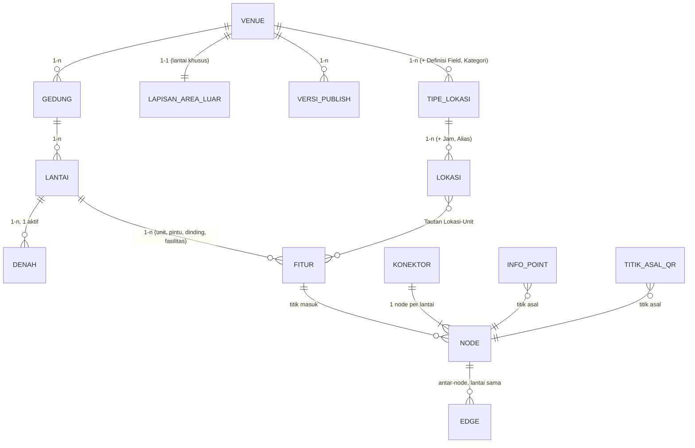

# Model Data Konseptual

Model data ini terdiri dari 28 entitas dalam 6 kelompok, ditulis secara konseptual tanpa terikat database tertentu, sehingga dapat diterapkan di Supabase sekarang dan dipindah ke Postgres atau database SQL lain nanti. Geometri disimpan dalam format GeoJSON; nilai field kustom disimpan sebagai objek kunci-nilai pada lokasi.

| Kelompok | Entitas |
| --- | --- |
| Struktur | Venue, Template Venue, Gedung, Lantai, Denah |
| Peta | Fitur, Jenis Fasilitas, Pengaturan Tampilan |
| Navigasi | Node, Edge, Konektor, Penutupan, Template Instruksi |
| Lokasi | Tipe Lokasi, Definisi Field, Kategori, Lokasi, Tautan Lokasi-Unit, Jam Operasional, Alias Pencarian |
| Perangkat dan publish | Titik Asal QR, Info Point, Token Perangkat, Versi Publish, Kunci Edit |
| Akses dan lisensi | Pengguna, Lisensi, Pengaturan Sistem |

## Diagram relasi

Entitas pendukung (Definisi Field, Kategori, Jam Operasional, Alias, Edge, Penutupan, Token Perangkat) ditulis di dalam kotak induknya. Lisensi dan Pengguna tidak digambar: Lisensi berlaku satu per instalasi dan membatasi kuota Venue, Gedung, Lantai, serta Info Point.

## Entitas dan atribut utama

Setiap entitas punya ID unik, waktu dibuat, dan waktu diubah; atribut itu tidak diulang di tabel.

### Struktur

| Entitas | Atribut utama | Relasi |
| --- | --- | --- |
| Venue | nama, alamat, koordinat pusat, logo, zona waktu, tipe venue, gedung default | punya banyak Gedung; memakai satu Template Venue saat dibuat |
| Template Venue | tipe (rumah sakit, kampus, perkantoran, bandara/stasiun, pabrik/gudang, pusat perbelanjaan, kustom), isi bawaan: tipe lokasi, kategori, jenis fasilitas, field kustom | disalin ke Venue saat dibuat; tidak tertaut setelahnya |
| Gedung | venue, nama, kode, footprint (poligon), lantai default | milik satu Venue; punya banyak Lantai |
| Lantai | gedung (kosong untuk lapisan Area Luar yang dimiliki langsung oleh Venue), nama tampilan, nomor level, tinggi (m), urutan | milik satu Gedung; punya banyak Denah, Fitur, Node |
| Denah | lantai, file asli, format (gambar, PDF, DWG, DXF), gambar hasil konversi, layer CAD terpilih, 4 titik sudut georeferensi, rotasi, skala, opasitas, aktif ya/tidak | milik satu Lantai; hanya satu yang aktif |

### Peta

| Entitas | Atribut utama | Relasi |
| --- | --- | --- |
| Fitur | lantai, jenis (unit, koridor, dinding, pintu, area non-akses, area luar gedung, fasilitas, landmark), geometri, tinggi override, warna override; khusus unit: kode unit, luas m², status unit; khusus fasilitas: jenis fasilitas, nama | milik satu Lantai |
| Jenis Fasilitas | venue, nama, ikon | dipakai Fitur jenis fasilitas |
| Pengaturan Tampilan | venue, tinggi default dan warna per jenis fitur, mode default 2D/3D, kamera awal (pitch, zoom, rotasi), branding (logo, warna utama, nama tampilan) | satu per Venue |

### Navigasi

| Entitas | Atribut utama | Relasi |
| --- | --- | --- |
| Node | lantai, posisi, peran (jalur, titik masuk unit, titik masuk fasilitas, titik asal QR, titik Info Point, ujung konektor) | milik satu Lantai; dapat tertaut ke satu Fitur |
| Edge | node asal, node tujuan, panjang (m), aksesibel ya/tidak, di luar gedung ya/tidak | menghubungkan dua Node di lantai yang sama atau antar-gedung |
| Konektor | venue, jenis (lift, eskalator, tangga, pintu gedung yang menghubungkan lantai dasar gedung dengan Area Luar), nama, arah (naik, turun, dua arah; untuk eskalator), aksesibel ya/tidak | punya satu Node per lantai yang dilayani |
| Penutupan | target (Fitur area, Edge, atau Konektor), alasan, waktu mulai, waktu selesai, dibuat oleh | menunjuk satu target |
| Template Instruksi | venue, jenis aksi (mulai, lurus, belok kiri, belok kanan, lift, eskalator, tangga, keluar gedung, masuk gedung, tiba), teks ID, teks EN | satu set per Venue |

### Lokasi

| Entitas | Atribut utama | Relasi |
| --- | --- | --- |
| Tipe Lokasi | venue, nama, ikon, warna | punya banyak Definisi Field dan Kategori |
| Definisi Field | tipe lokasi, kunci, label, jenis (teks, angka, pilihan, jam operasional, gambar, tautan), opsi pilihan, wajib, tampil di Visitor, dapat dicari, urutan | milik satu Tipe Lokasi |
| Kategori | tipe lokasi, nama, ikon, urutan | milik satu Tipe Lokasi; dipakai banyak Lokasi |
| Lokasi | venue, kode lokasi (opsional, unik), tipe lokasi, nama, deskripsi, logo/foto, status (aktif, segera buka, nonaktif sementara, nonaktif permanen), tanggal buka, nilai field kustom | punya banyak Kategori, Tautan Lokasi-Unit, Alias |
| Tautan Lokasi-Unit | lokasi, fitur unit, unit utama ya/tidak | satu unit hanya milik satu Lokasi aktif |
| Jam Operasional | lokasi, hari (1-7) atau tanggal khusus, jam buka, jam tutup, tutup ya/tidak | milik satu Lokasi |
| Alias Pencarian | target (Lokasi, Kategori, atau Jenis Fasilitas), kata kunci | menunjuk satu target |

### Perangkat dan publish

| Entitas | Atribut utama | Relasi |
| --- | --- | --- |
| Titik Asal QR | venue, gedung, lantai, nama, posisi, arah hadap (derajat), kode QR unik | tertaut ke satu Node |
| Info Point | venue, gedung, lantai, kode, nama, posisi, arah hadap (derajat), mode 2D/3D, paksa 2D, bahasa default, durasi idle; heartbeat terakhir dan versi yang dimuat (F2) | tertaut ke satu Node |
| Token Perangkat (F2) | Info Point, kode pairing, token, status (menunggu, aktif, dicabut), kedaluwarsa kode | milik satu Info Point |
| Versi Publish | venue, nomor versi, snapshot, catatan rilis, dipublish oleh, waktu, aktif ya/tidak, asal (publish atau rollback) | milik satu Venue; hanya satu yang aktif |
| Kunci Edit | lantai, pengguna, waktu mulai, aktivitas terakhir | satu per Lantai |

### Akses dan lisensi

| Entitas | Atribut utama | Relasi |
| --- | --- | --- |
| Pengguna | nama, email, role (Super Admin, Admin, Editor, Operator, Viewer), status aktif | membuat perubahan, Penutupan, Versi Publish |
| Lisensi | ID lisensi, klien, paket, tanggal mulai dan berakhir, kuota, fitur, instance\_id, tanda tangan, status (aktif, masa tenggang, kedaluwarsa, dicabut), check-in terakhir, waktu terakhir terlihat, sumber (online atau unggah manual) | satu yang berlaku per instalasi; riwayat disimpan |
| Pengaturan Sistem | URL publik Visitor, server email (SMTP), zona waktu default, bahasa default | satu per instalasi |

## Aturan integritas data

1. Semua entitas, langsung atau lewat induknya, terikat ke satu Venue; tidak ada data yang melintasi venue.
2. Kode unit unik dalam satu Venue; kode lokasi, jika diisi, juga unik dalam satu Venue.
3. Satu Fitur unit hanya boleh tertaut ke satu Lokasi berstatus aktif, segera buka, atau nonaktif sementara.
4. Edge hanya menghubungkan Node di lantai yang sama; perpindahan lantai, serta perpindahan antara gedung dan lapisan Area Luar, hanya lewat Konektor (lift, eskalator, tangga, pintu gedung).
5. Konektor eskalator dengan arah naik atau turun hanya boleh dilalui sesuai arahnya.
6. Setiap Lantai hanya punya satu Denah aktif, dan setiap Venue hanya punya satu Versi Publish aktif.
7. Menghapus Lantai, Gedung, atau Venue tidak boleh menghapus data turunan tanpa konfirmasi; Lokasi dan Info Point yang tertaut dilepas dulu.
8. Nilai field kustom pada Lokasi harus sesuai Definisi Field tipe lokasinya; field wajib divalidasi sebelum publish.
9. Versi Publish bersifat tidak dapat diubah (immutable); rollback membuat Versi Publish baru yang menyalin snapshot lama.
10. Jumlah Venue, Gedung, Lantai, dan Info Point tidak boleh melebihi kuota Lisensi yang berlaku.
11. Data draft dan snapshot published terpisah: perubahan draft tidak pernah mengubah snapshot.
12. Penutupan berlaku langsung pada rute di Visitor dan Info Point tanpa menunggu publish.
