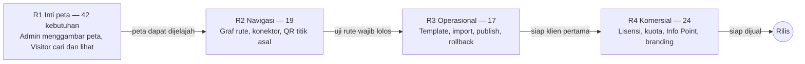

# Non-Fungsional & Rencana Rilis

Tab ini menetapkan 22 kebutuhan non-fungsional yang berlaku untuk seluruh sistem, dan membagi 102 kebutuhan MVP menjadi empat rilis yang masing-masing dapat diuji di lokal sebelum lanjut. Target angka adalah titik awal dan dapat disesuaikan setelah pengujian pertama.

## Kebutuhan non-fungsional (NFR)

### Performa dan kapasitas

| ID | Kebutuhan | Target | Prioritas |
| --- | --- | --- | --- |
| NFR-PERF-01 | Muat awal Visitor | ≤ 3 detik di jaringan 4G untuk venue hingga 10 lantai dan 2.000 fitur; kunjungan ulang ≤ 1,5 detik | MVP |
| NFR-PERF-02 | Hitung rute | ≤ 500 ms di HP kelas menengah, termasuk rute antar-lantai dan antar-gedung | MVP |
| NFR-PERF-03 | Kelancaran editor | Menggambar dan menggeser tetap lancar untuk lantai hingga 1.000 fitur | MVP |
| NFR-PERF-04 | Waktu publish | Validasi dan publish satu venue ≤ 60 detik | MVP |
| NFR-CAP-01 | Kapasitas | Satu server klien melayani minimal 200 pengunjung dan 20 pengguna Admin secara bersamaan | MVP |

### Kompatibilitas

| ID | Kebutuhan | Target | Prioritas |
| --- | --- | --- | --- |
| NFR-COMP-01 | Browser | Chrome, Edge, Safari, dan Firefox, dua versi terbaru | MVP |
| NFR-COMP-02 | Perangkat pengunjung | Android 10 ke atas dan iOS 15 ke atas; lebar layar mulai 360 px | MVP |
| NFR-COMP-03 | Admin | Desktop atau laptop dengan layar minimal 1280 px. Pengecualian: menu Penutupan harus dapat dipakai dari HP, karena Operator bekerja di lapangan | MVP |
| NFR-COMP-04 | Info Point | Layar sentuh Windows 10/11 dengan Chrome atau Edge, orientasi potret maupun lanskap, resolusi minimal 1080p | MVP |

### Keamanan dan privasi

| ID | Kebutuhan | Target | Prioritas |
| --- | --- | --- | --- |
| NFR-SEC-01 | Transport | Semua akses lewat HTTPS | MVP |
| NFR-SEC-02 | Akun | Password disimpan dalam bentuk hash; panjang minimal 8 karakter; akun terkunci sementara setelah 5 kali gagal login | MVP |
| NFR-SEC-03 | Otorisasi | Setiap aksi diperiksa di server sesuai role dan lisensi, bukan hanya disembunyikan di UI | MVP |
| NFR-SEC-04 | Unggahan | Tipe file diperiksa; ukuran maksimal 50 MB per denah dan 5 MB per gambar | MVP |
| NFR-SEC-05 | Catatan penting | Login, publish, rollback, perubahan role, dan perubahan lisensi dicatat dalam Log Aktivitas (audit log lengkap di F2) | MVP |
| NFR-SEC-06 | Privasi pengunjung | Visitor dan Info Point tidak menyimpan data pribadi; sesuai UU Pelindungan Data Pribadi | MVP |

### Keandalan

| ID | Kebutuhan | Target | Prioritas |
| --- | --- | --- | --- |
| NFR-REL-01 | Backup | Database dan file dibackup otomatis setiap hari, disimpan 14 hari, dan dapat dipulihkan | MVP |
| NFR-REL-02 | Pembaruan aplikasi | Update versi tanpa kehilangan data; migrasi database otomatis dengan backup sebelum update | MVP |
| NFR-REL-03 | Gangguan server | Visitor dan Info Point tetap dapat dipakai dengan versi tersimpan saat server tidak terjangkau sementara | MVP |

### Kegunaan dan pemeliharaan

| ID | Kebutuhan | Target | Prioritas |
| --- | --- | --- | --- |
| NFR-USE-01 | Keterbacaan dan bahasa | Kontras warna minimal WCAG AA; target sentuh minimal 44 px di Visitor dan 60 px di Info Point. Antarmuka Admin, Visitor, dan Info Point tersedia dalam Bahasa Indonesia dan Inggris | MVP |
| NFR-MNT-01 | Satu paket deploy | Paket yang sama berjalan di komputer lokal untuk testing dan di server klien | MVP |
| NFR-MNT-02 | Portabilitas data | Model data tidak bergantung pada fitur khusus satu penyedia database, agar dapat dipindah dari Supabase ke Postgres atau database SQL lain | MVP |
| NFR-MNT-03 | Format geometri | Geometri disimpan sebagai GeoJSON dengan koordinat WGS84 | MVP |

## Rencana rilis

Setiap rilis berakhir di gerbang: kriteria penerimaannya harus lolos di lokal sebelum rilis berikutnya dimulai. Rilis tidak diberi tanggal karena bergantung pada kecepatan pengerjaan.

## Pemetaan kebutuhan MVP ke rilis

| Rilis | Kebutuhan fungsional | Jumlah | Gerbang selesai |
| --- | --- | --- | --- |
| R1 Inti peta | FR-AUTH-01 s.d. 04 · FR-SYS-01 · FR-VEN-01, 03 s.d. 10 · FR-MAP-01 s.d. 10 · FR-VIS-01 s.d. 06 · FR-LOC-03, 04, 07, 10 · FR-VST-01 s.d. 06, 11, 19 | 42 | Satu venue multi-gedung dapat digambar di Admin dan dijelajahi, dicari, serta dibuka detail lokasinya di Visitor |
| R2 Navigasi | FR-NAV-01 s.d. 11 · FR-DEV-01, 02 · FR-VST-07 s.d. 10, 12, 13 | 19 | Semua skenario uji rute wajib lolos, termasuk mode aksesibel, penutupan, dan QR titik asal |
| R3 Operasional | FR-AUTH-05 · FR-VEN-02 · FR-LOC-01, 02, 05, 06, 08, 09 · FR-PUB-01 s.d. 08 · FR-VST-14 | 17 | Venue dari template dapat diisi lewat import, divalidasi, dipublish, dan di-rollback; role Operator dan Viewer berfungsi |
| R4 Komersial | FR-LIC-01 s.d. 12 · FR-DEV-03, 04 · FR-IP-01 s.d. 08 · FR-VIS-07 · FR-VST-15 | 24 | Instalasi baru dapat diaktivasi, kuota dan masa tenggang berlaku, Info Point berjalan di layar sentuh |
| **Total** |  | **102** |  |

**Catatan penerapan:**

- Kebutuhan non-fungsional berlaku sejak R1; NFR-MNT-01 (satu paket deploy) dan NFR-MNT-02 (portabilitas data) sebaiknya dipenuhi di awal karena mahal diubah belakangan.
- Selama R1 sampai R3, sistem berjalan dalam mode pengembangan tanpa lisensi. Namun titik pemeriksaan lisensi dan kuota di server sebaiknya sudah disiapkan sejak R1 (FR-LIC-06 bergantung padanya), agar R4 tinggal mengaktifkannya.
- Matriks role lengkap (termasuk Operator dan Viewer) dibuat di R1 lewat FR-AUTH-04; fungsi penutupan untuk Operator baru dapat diuji di R2.
- Di R1, lokasi memakai satu tipe lokasi bawaan tanpa field kustom; tipe lokasi, field kustom, dan template industri lengkap masuk di R3. Setiap rilis dianggap selesai jika semua kriteria penerimaan kebutuhan di rilis itu lolos.
